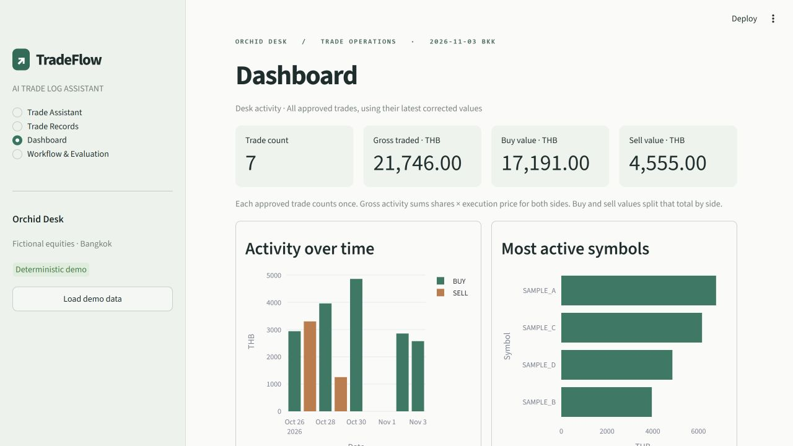

# TradeFlow — AI Trade Log Assistant

A local operations workspace for Orchid Desk, a fictional Thai equities desk. Paste a desk message, inspect the proposed fields, then approve a versioned SQLite change. Try the entire workflow without an API key.



## Start in demo mode

Tested on Windows with Python 3.12. From the extracted project directory in PowerShell:

```powershell
py -3.12 -m venv .venv
.\.venv\Scripts\python.exe -m pip install -r requirements.txt
.\.venv\Scripts\python.exe -m streamlit run app.py
```

Open the local URL printed by Streamlit, usually http://localhost:8501. On macOS/Linux, use `python3.12 -m venv .venv` and substitute `.venv/bin/python` in the next two commands. Demo mode needs no .env file.

Select **Load demo data** to add six trades across four fictional symbols and one historical price correction. Loading again skips existing references. The database starts empty and lives at `data/tradeflow.sqlite3`; set `TRADEFLOW_DB` to use another ledger. Duplicate attempts and incomplete messages are available as sample tickets rather than booked trades.

## Two-minute interview walkthrough

| Time | Show | Talk track |
|---|---|---|
| 0:00–0:20 | Load demo data. Open **Trade Assistant → New trade → Prepare proposal**. | “This fictional desk receives unstructured messages. Here T104 is the desk’s reference. Python checks the date, quantity and price. One hundred shares at THB 25.50 gives THB 2,550.00.” |
| 0:20–0:45 | Approve T104. Select **Correction**, then prepare it. | “The assistant looks up T104 and shows the old and proposed price. Approval checks the version again so another reviewer’s edit can’t be overwritten.” |
| 0:45–1:05 | Approve the correction. Search T104 in **Trade Records** and expand its history. | “The internal ID stays fixed. Both approvals have their source message and timestamp. The new price is THB 25.75, and gross activity increases by THB 25.” |
| 1:05–1:30 | Prepare **Duplicate**, show the acknowledgement gate, discard it. Prepare **Missing price**, reply `THB 19.80`. | “An identical execution can be legitimate, so it merits review. A missing price requires clarification. The original sell instruction stays attached, and today resolves to the Bangkok date.” |
| 1:30–2:00 | Leave that ticket pending. Open **Dashboard**, then **Workflow & Evaluation**. | “Approved activity and unfinished work are counted separately. Demo results come from repeatable templates. The live path uses the same Python tools, and I show its evaluation separately.” |

Use a fresh database path for a repeat presentation if T104 is already booked. The **Ambiguous** sample matches multiple SAMPLE_A records. Reply with a listed external reference to select a target.

## How the pieces fit

| File | Responsibility |
|---|---|
| `app.py` | Four Streamlit views, explicit user actions, session-local review state, filtered CSV export and Plotly charts. |
| `agent.py` | Five strict function schemas, source-evidence checks, candidate lookup and a bounded Responses API loop. Lookup results feed the next model turn. Preparation and clarification terminate it. |
| `demo.py` | Small English template interpreter and reproducible seed trades. Both interpreters call the same read/prepare tools. |
| `ledger.py` | Two SQLite tables, parameterized queries, deterministic field validation and transaction handling. |
| `evaluate.py`, `evaluation/`, `tests/` | Independent expected labels, measured results, regression tests and mock SDK integration. |

Approved trades have a numeric internal ID, optional unique external reference, current economic fields, original source, UTC timestamps and a version. Prices use integer satang. Python multiplies satang by whole shares and sums in integer arithmetic. Gross traded value measures turnover. Each record contributes once at its currently approved price and quantity.

Approval takes a SQLite write lock, rechecks references, economic duplicates, target version and warning acknowledgement, then writes the trade and its audit snapshot in one transaction. The unique proposal token makes repeated approval idempotent. A correction retains the original intake text in the trade row and records the correction message alongside full before/after snapshots in the audit table.

The dashboard queue covers the pending ticket in the current browser session. Approved records survive application restarts. A lost session drops its unapproved draft.

## Optional live mode

Copy `.env.example` to `.env`, set `TRADEFLOW_MODE=live`, supply your own `OPENAI_API_KEY`, and restart Streamlit. `OPENAI_MODEL` defaults to `gpt-4.1-mini`; choose an accessible model supporting Responses function calling. Each explicit prepare or clarification submission may make up to five paid requests. Startup, navigation, approval and ordinary reruns never invoke the API. Synthetic ticket text and matching trade fields are sent to the configured model.

The integration uses the official Python SDK, strict function arguments, one tool call per round and structured results joined by call ID. A malformed response, API error or exhausted budget leaves the ledger untouched. [Official OpenAI function-calling documentation](https://developers.openai.com/api/docs/guides/function-calling)

## Verification and evaluation

Run these with the project environment's Python from this directory:

```text
python -m unittest discover -s tests -v
python evaluate.py
python evaluate.py --live
```

The first two commands are offline. The third explicitly starts a paid evaluation and requires a configured key. Both evaluation modes use a temporary seeded database, the same 21 labeled tickets and a fixed Bangkok date of 2026-11-03. Neither changes the application ledger. Detailed outcomes go to `evaluation/demo_results.json` or `evaluation/live_results.json` and the workflow view reads those reports.

| Measured deterministic metric | Correct / scored |
|---|---:|
| Action classification | 21 / 21 |
| Labeled field extraction | 78 / 78 |
| Clarification required vs. proceed | 21 / 21 |
| Ordered tool sequence | 21 / 21 |
| Validation outcome | 21 / 21 |

Field extraction compares the explicitly labeled fields in each case, including optional references. Validation distinguishes clean, warning, blocked, blocked with warning, and clarification. API failures count as failures in the live scoring. These fixtures reuse the demo sentence patterns. **Live evaluation: not run.** The installed SDK was exercised against an in-process mock HTTP service for tool-result round trips, invalid JSON, service failures and the iteration bound.

## Scope and limitations

- Demo mode handles the sample sentence patterns and short clarification replies. Use live mode to try arbitrary messages. Model interpretation can still be wrong, so inspect every proposed field.
- Four fictional THB symbols, whole-share quantities up to one billion and prices below THB one billion with at most two decimals. Reference-free corrections require a unique candidate. Duplicate detection compares date, symbol, side, quantity and price exactly.
- This is a single-desk portfolio prototype with local SQLite storage. It has no authentication, brokerage connection, market-data feed or order execution. Live model availability, latency and real-world extraction quality have not been measured.

**Resume bullet**  
Built a Python/Streamlit trade-log assistant with approval-gated SQLite updates, versioned correction history and a Plotly activity dashboard; verified deterministic handling of 21 synthetic trade messages.

